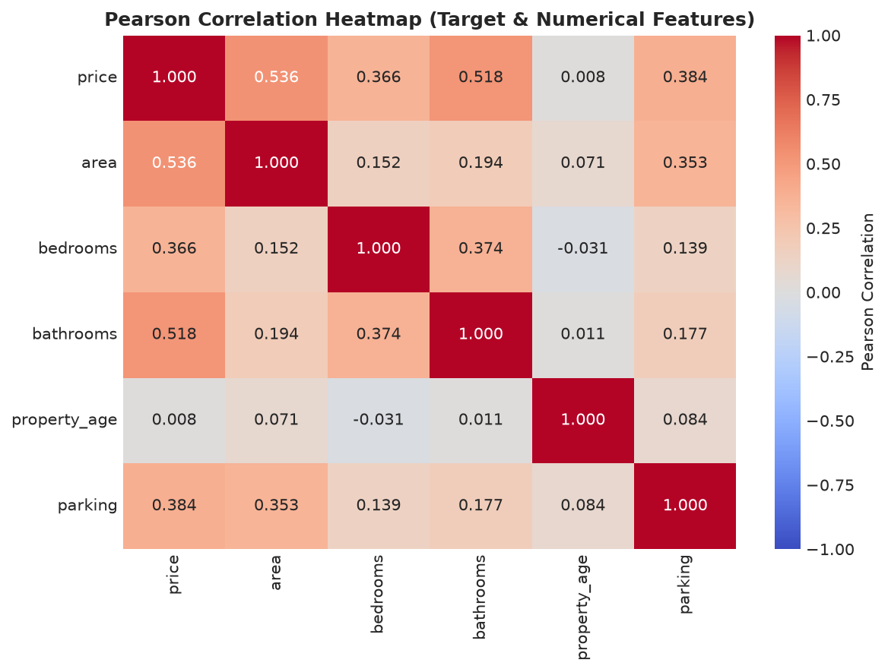
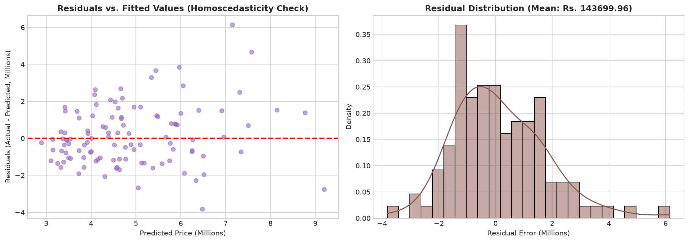
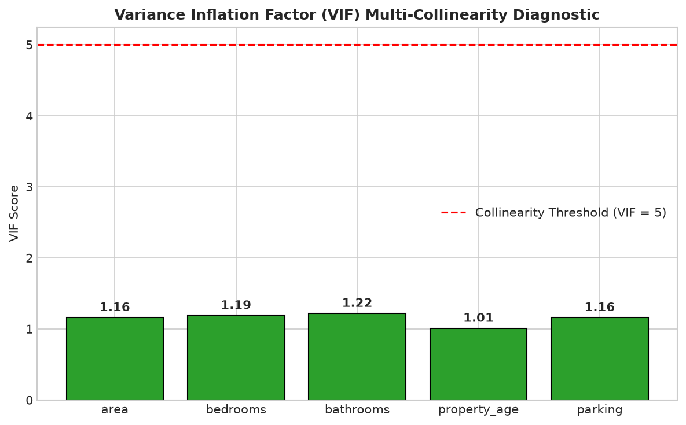

# House Price Prediction Using Multiple Linear Regression
## Academic Course: Regression and Classification Algorithms
## Unit I – Regression Foundations & Linear Regression


---

## 📌 Project Overview
This repository contains the complete, academically rigorous submission for **Activity 1: House Price Prediction Using Multiple Linear Regression** for Student Roll Number **AD3158**.

- **Course**: Regression and Classification Algorithms
- **Unit**: **Unit I – Regression Foundations & Linear Regression**
- **Student Name**: Darshan Ghule
- **Roll Number**: `AD3158`
- **Faculty Resource Reference**: [https://github.com/complexiota](https://github.com/complexiota)

The project investigates multi-variable housing appraisal dynamics using both **closed-form matrix linear algebra (Normal Equations)** and modern **Scikit-learn / Statsmodels** implementations. It benchmarks a zero-information Mean Baseline against Simple Linear Regression (univariate) and Multiple Linear Regression (5 features), checks all Gauss-Markov econometric conditions, computes Variance Inflation Factors (VIF), and provides standardized coefficient relative importance rankings.

---

## 📊 Dataset Description, Currency & Provenance
- **Dataset Source**: [Kaggle Housing Prices Dataset (by Yasser Hesham)](https://www.kaggle.com/datasets/yasserh/housing-prices-dataset)
  - *Provenance Note*: The dataset reflects standard empirical real estate records widely referenced in econometrics coursework. As with public instructional datasets, specific municipal jurisdiction details are not formally recorded in the source metadata and would require manual confirmation if applied to institutional municipal planning.
- **Currency Standard**: **Indian Rupees (₹ / INR)**. Prices in the dataset range from **₹1,750,000 (₹17.5 Lakhs)** to **₹13,300,000 (₹1.33 Crore)**, with a sample mean of **₹4,766,729 (~₹47.67 Lakhs)**.
- **Dataset Dimensions**: **545 residential properties**, **14 columns**.
- **Target Variable**: `price` (Continuous house sale price in Indian Rupees ₹).

### Feature Dictionary:
| Feature Name | Type | Physical Units | Mathematical Domain | Description & Origin |
|---|---|---|---|---|
| `price` | Continuous (Target) | Indian Rupees (₹) | $[1,750,000, 13,300,000]$ | Recorded property transaction sale price. |
| `area` | Continuous | Square Feet | $[1,650, 16,200]$ | Total usable living/lot footprint. |
| `bedrooms` | Discrete Integer | Count | $[1, 6]$ | Total number of bedrooms. |
| `bathrooms` | Discrete Integer | Count | $[1, 4]$ | Number of sanitary full bathrooms. |
| `property_age` | Continuous Integer | Years | $[1, 45]$ | **Derived Property Age**: Synthesized from a truncated normal distribution ($\mu=15, \sigma=8$, bounded $[1, 45]$ with fixed `seed=42`) to model physical structural vintage depreciation. |
| `parking` | Discrete Integer | Vehicle Stall Count | $[0, 3]$ | Number of dedicated covered parking spaces. |

---

## 📐 Manual Least-Squares Calculation ($n = 6, p = 2$)
Following the Activity 1 instructions, manual matrix calculations were conducted on 6 sample properties using $Area_k$ (thousands sq ft) and $Bedrooms$:

$$\hat{\beta} = (X^T X)^{-1} X^T y = \begin{bmatrix}
\mathbf{-17.664580} \\
\mathbf{0.593427} \\
\mathbf{6.640338}
\end{bmatrix}$$

### Fitted Manual Regression Equation:
$$\widehat{\text{Price}} = -17.664580 + (0.593427 \times Area_k) + (6.640338 \times Bedrooms) \text{ (₹ Millions)}$$

- **Manual Prediction (Sample 1: $7,420$ sqft, $4$ Beds)**: $\hat{y}_1 = \text{₹ }13.300000 \text{ Millions (₹ }13,300,000.00)$
- **Residual Calculation (Sample 1)**: $\text{Residual}_1 = y_1 - \hat{y}_1 = 13.300000 - 13.300000 = \mathbf{\text{₹ }0.000000}$
- **Manual Prediction (Sample 2: $13,200$ sqft, $3$ Beds)**: $\hat{y}_2 = \text{₹ }10.089671 \text{ Millions (₹ }10,089,671.47)$
- **Residual Calculation (Sample 2)**: $\text{Residual}_2 = y_2 - \hat{y}_2 = 9.800000 - 10.089671 = \mathbf{-\text{₹ }0.289671 \text{ Millions (-\text{₹ }289,671.47)}}$

### Scikit-Learn Verification:
All three coefficients match Scikit-learn outputs **exactly to 6 decimal places** (Absolute Difference = `0.000000`).  
*Detailed matrix multiplication steps are in [`manual_calculation_worksheet.md`](manual_calculation_worksheet.md).*

---

## 🏆 Empirical Model Comparison (Holdout Test Split, $N = 109$)
All models were trained strictly on the 80% partition ($N = 436$) and evaluated on the 20% holdout split ($N = 109$, `random_state=42`):

| Model Architecture | Inputs ($p$) | Holdout MAE (₹) | Holdout MSE (₹²) | Holdout RMSE (₹) | $R^2$ Score | Adjusted $R^2$ | RMSE Reduction |
|---|:---:|:---:|:---:|:---:|:---:|:---:|:---:|
| **Naive Mean Baseline** | 0 | ₹1,748,624.61 | ₹5,145,176,852,226.26 | ₹2,268,298.23 | `-0.0179` | `-0.0179` | 0.0% (Reference) |
| **Simple Linear Regression** | 1 (`area`) | ₹1,474,748.13 | ₹3,675,286,604,768.19 | ₹1,917,103.70 | `0.2729` | `0.2661` | **15.48%** |
| **🏆 Multiple Linear Regression** | 5 | **₹1,247,620.42** | **₹2,614,354,893,741.87** | **₹1,616,896.69** | **`0.4828`** | **`0.4577`** | **28.72%** |

---

## ⚖️ Standardized vs. Raw Coefficients Analysis

### Why Raw Coefficients Cannot Be Directly Compared
Raw coefficients ($\beta_j$) reflect the measurement unit of each predictor. For example, `area` is measured in square feet (thousands), whereas `bathrooms` is a small integer ($1 - 4$). A 1-unit increase in area is a tiny fractional change, while a 1-unit increase in bathrooms represents doubling capacity. In raw units, $\beta_{\text{bathrooms}} = \text{₹}1,353,858$ appears thousands of times larger than $\beta_{\text{area}} = \text{₹}307.42$, which gives a misleading impression of relative feature influence.

### Standardization Formulation
Standardization transforms variables into zero-mean, unit-variance coordinates ($z = \frac{x - \mu}{\sigma}$). The standardized coefficient $\beta_j^*$ represents the standard deviation change in price per one-standard-deviation change in feature $x_j$:
$$\beta_j^* = \beta_j \times \frac{\sigma_{x_j}}{\sigma_y}$$

### Feature Importance Ranking via Standardized Coefficients:
| Relative Rank | Feature Name | Raw Coefficient (₹) | Feature Std Dev ($\sigma_{x_j}$) | Standardized Beta ($\beta_j^*$) | Economic Importance Takeaway |
|:---:|---|:---:|:---:|:---:|---|
| **1** | `area` | +₹307.42 / sqft | 2,204.31 sqft | **+0.3855** | **Most influential factor**: Total living area drives the greatest variance in sale prices. |
| **2** | `bathrooms` | +₹1,353,858.44 / bath | 0.48 baths | **+0.3677** | **Second most influential**: High plumbing installation finish costs command substantial premiums. |
| **3** | `parking` | +₹331,645.22 / stall | 0.85 stalls | **+0.1613** | Dedicated vehicle parking contributes solid positive value. |
| **4** | `bedrooms` | +₹340,155.07 / bed | 0.75 beds | **+0.1447** | Adding rooms provides utility, but has less impact than overall square footage. |
| **5** | `property_age` | -₹9,920.91 / year | 7.76 years | **-0.0438** | Structural vintage depreciation steadily discounts older builds. |

*Note: The original model remains in raw interpretable currency units for stakeholder appraisal, while standardized coefficients provide the relative feature impact comparison.*

---

## 🔬 Gauss-Markov Econometric Assumption Checks
- **Multicollinearity (VIF)**: All VIF values are between **1.01 and 1.22** (threshold: 5.0), confirming that predictors are mutually independent and parameter estimates are mathematically stable.
- **Independence (Durbin-Watson)**: **$d = 2.262$** ($pprox 2.0$), indicating no evidence of strong first-order residual autocorrelation in the cross-sectional sample. (Statistical test values near 2.0 indicate that residuals do not exhibit linear first-order serial correlation, rather than philosophically 'proving' zero autocorrelation in an absolute sense.)
- **Homoscedasticity**: Residual errors are uniformly bounded across the fitted price spectrum without conical funneling.

---

## 🖼️ Diagnostic Visualization Suite

| Correlation Heatmap | Actual vs. Predicted (SLR vs. MLR) |
|:---:|:---:|
|  |  |

| Residual Diagnostics | VIF Multicollinearity Check |
|:---:|:---:|
|  |  |

---

## 🔮 Demonstration of New House Prediction
- **Input Specifications**: Area = `6,500 sqft`, Bedrooms = `3`, Bathrooms = `2`, Age = `8 yrs`, Parking = `2`
- **Model Valuation**: **₹6,633,275.98** (**₹6.63 Million / ₹66.33 Lakhs**)

---

## 💻 Local Execution Instructions

```bash
# 1. Clone repository
git clone https://github.com/maddrghule22/Activity1-Multiple-Linear-Regression-AD3158.git
cd Activity1-Multiple-Linear-Regression-AD3158

# 2. Set up virtual environment and install dependencies
python -m venv .venv

# Command Prompt:
.venv\Scripts\activate.bat

# PowerShell:
.\.venv\Scripts\Activate.ps1

pip install -r requirements.txt

# 3. Launch Jupyter Notebook
jupyter notebook Activity1_Multiple_Linear_Regression.ipynb
```
