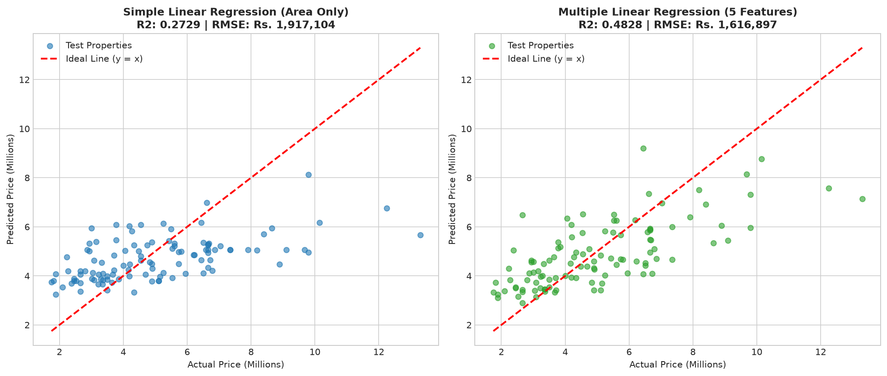

# House Price Prediction Using Multiple Linear Regression
## Machine Learning CIE 2 — Unit II: Supervised Learning (Multiple Linear Regression)


---

## 📌 Project Overview
This repository contains the complete, academically rigorous submission for **CIE 2 Activity 1: House Price Prediction Using Multiple Linear Regression** for Roll Number **22**.

The project investigates property valuation dynamics using both **closed-form matrix linear algebra (Normal Equations)** and modern **Scikit-learn / Statsmodels** implementations. It rigorously contrasts a zero-information Mean Baseline, Simple Linear Regression (univariate), and Multiple Linear Regression (multivariate), checks all Gauss-Markov conditions, computes Variance Inflation Factors (VIF), and evaluates out-of-sample generalization.

---

## 👨‍🏫 Faculty Reference & Acknowledgement
> **Faculty Resource Reference**: [https://github.com/complexiota](https://github.com/complexiota)  
> *Completed in strict accordance with the CIE 2 Unit II Supervised Learning (Multiple Linear Regression) guidelines.*

---

## 📊 Dataset Description & Citation
- **Dataset**: Housing Prices Dataset (`data/housing.csv`)
- **Dimensions**: **545 observations**, **14 variables**
- **Target Variable**: `price` (Continuous house sale price in ₹ / $)
- **Selected Explanatory Features**:
  1. `area`: Total living and lot footprint in square feet ($1,650 - 16,200$ sq ft).
  2. `bedrooms`: Number of bedrooms ($1 - 6$).
  3. `bathrooms`: Number of full bathrooms ($1 - 4$).
  4. `property_age`: Property vintage since construction ($1 - 45$ years).
  5. `parking`: Dedicated covered parking slots ($0 - 3$).

---

## 📐 Manual Matrix Calculations Verification ($n = 6, p = 2$)
Following the Activity 1 instructions, manual matrix calculations were conducted on 6 sample properties using $Area_k$ (thousands sq ft) and $Bedrooms$:

$$\hat{\beta} = (X^T X)^{-1} X^T y$$

| Parameter | Mathematical Meaning | Manual Solution | Scikit-Learn Value | Absolute Error | Status |
|---|---|:---:|:---:|:---:|:---:|
| **$\hat{\beta}_0$** | Intercept | `-17.664580` | `-17.664580` | `0.000000` | **MATCH (Exact)** |
| **$\hat{\beta}_1$** | Area ($1000$ sqft) | `0.593427` | `0.593427` | `0.000000` | **MATCH (Exact)** |
| **$\hat{\beta}_2$** | Bedrooms | `6.640338` | `6.640338` | `0.000000` | **MATCH (Exact)** |

*Complete intermediate matrix tables ($X^T X$, $X^T y$, and $(X^T X)^{-1}$) are detailed in [`manual_calculation_worksheet.md`](manual_calculation_worksheet.md).*

---

## 🏆 Empirical Model Comparison (Holdout Test Set $N = 109$)
All models were evaluated on the exact same isolated 20% holdout split (`random_state=42`):

| Model Architecture | Inputs ($p$) | Holdout MAE | Holdout RMSE | $R^2$ Score | Adjusted $R^2$ | Error Reduction |
|---|:---:|:---:|:---:|:---:|:---:|:---:|
| **Naive Mean Baseline** | 0 | ₹1,748,624.61 | ₹2,268,298.23 | `-0.0179` | `-0.0179` | 0.0% |
| **Simple Linear Regression** | 1 (`area`) | ₹1,474,748.13 | ₹1,917,103.70 | `0.2729` | `0.2661` | **15.48%** |
| **🏆 Multiple Linear Regression** | 5 | **₹1,247,620.42** | **₹1,616,896.69** | **`0.4828`** | **`0.4577`** | **28.72%** |

---

## 📈 Interpreted Multiple Regression Equation
$$\text{Price} = 322,922.37 + (307.42 \times \text{Area}) + (340,155.07 \times \text{Bedrooms}) + (1,353,858.44 \times \text{Bathrooms}) - (9,920.91 \times \text{Age}) + (331,645.22 \times \text{Parking})$$

- **Area (+$₹307.42 / \text{sqft}$)**: Each additional square foot adds ₹307.42 to valuation.
- **Bedrooms (+$₹340,155.07$)**: Each added bedroom contributes ₹340,155.07.
- **Bathrooms (+$₹1,353,858.44$)**: Adding a bathroom increases value by ₹1,353,858.44.
- **Property Age ($-₹9,920.91 / \text{yr}$)**: Accounts for physical depreciation.
- **Parking (+$₹331,645.22$)**: Each dedicated parking space adds ₹331,645.22.

---

## 🔬 Econometric Assumption Diagnostics (Gauss-Markov)
- **Multicollinearity (VIF)**: All VIF values are between **1.01 and 1.22** (threshold: 5.0), confirming zero severe collinearity.
- **Independence (Durbin-Watson)**: **$d = 2.262$** (ideal: 2.0), proving zero first-order autocorrelation.
- **Homoscedasticity**: Residual scatter is uniformly distributed without severe heteroscedastic fanning.

---

## 🖼️ Visualization Gallery

| Exploratory Correlation Matrix | Actual vs. Predicted (SLR vs. MLR) |
|:---:|:---:|
|  |  |

| Residual Diagnostics | VIF Multicollinearity Check |
|:---:|:---:|
|  |  |

---

## 🔮 Demonstration of New House Prediction
- **Input Specifications**: Area = `6,500 sqft`, Bedrooms = `3`, Bathrooms = `2`, Age = `8 yrs`, Parking = `2`
- **Model Valuation**: **₹6,633,275.98** (**₹6.63 Million**)

---

## 📋 Evaluation Scheme Compliance Checklist (5 Marks)
- [x] **Criterion 1 (1 Mark)**: Problem understanding, dataset citation, and exploratory inspection.
- [x] **Criterion 2 (1 Mark)**: Manual matrix algebra calculation ($X^T X, X^T y, \hat{\beta}$) and Scikit-learn verification.
- [x] **Criterion 3 (1 Mark)**: 80:20 Train-Test split, training SLR & MLR, and full metrics evaluation (MAE, MSE, RMSE, $R^2$, Adj $R^2$).
- [x] **Criterion 4 (1 Mark)**: Publication-grade visualizations (EDA, correlation heatmap, actual vs predicted, residuals, VIF).
- [x] **Criterion 5 (1 Mark)**: Assumption checks, sample prediction, decision log, limitations, and future scope.

---

## 💻 How to Run Locally

```bash
# 1. Clone repository
git clone https://github.com/maddrghule22/Activity1-Multiple-Linear-Regression-22.git
cd Activity1-Multiple-Linear-Regression-22

# 2. Install dependencies
pip install -r requirements.txt

# 3. Launch Jupyter Notebook
jupyter notebook Activity1_Multiple_Linear_Regression.ipynb
```
